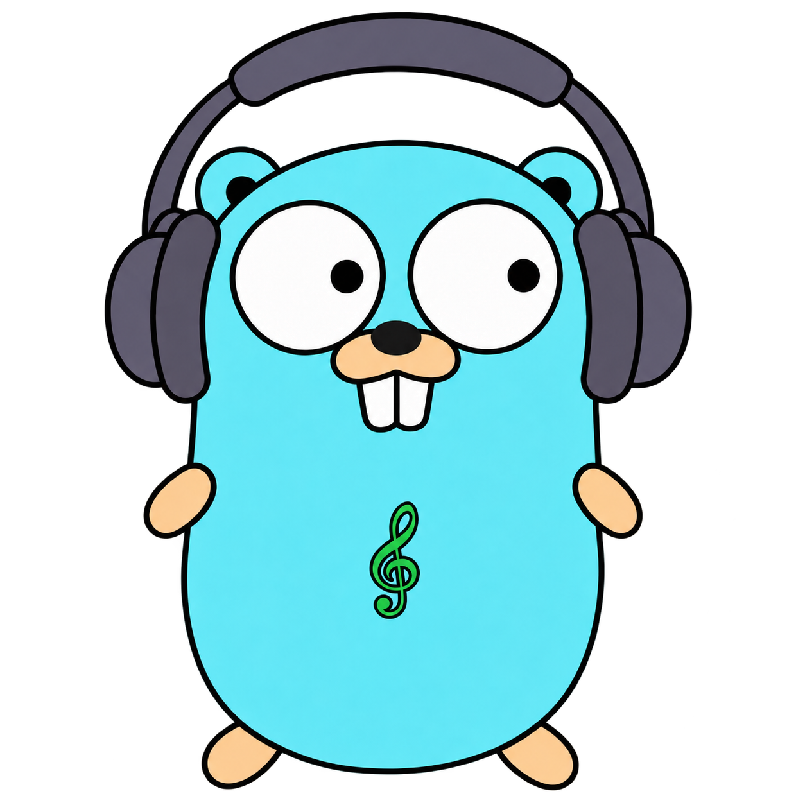

# spot-go

<p align="center">
  
</p>

A Spotify terminal UI.

## Requirements

- A Spotify Premium account. Spotify only lets the few accounts on the user list of spot-go's own Spotify app use it, so with another account you log in with your own Spotify app (see [Spotify app settings](#spotify-app-settings)).
- A program that plays the audio. spot-go uses [Soloist](https://developer.spotify.com/documentation/soloist), Spotify's own player, on:
  - macOS 13 or newer on Apple Silicon
  - Linux on x86_64, aarch64 or armv7, with PipeWire or PulseAudio

  spot-go downloads Soloist from Spotify on the first run. Soloist has no build for other platforms, such as Intel Macs, so spot-go doesn't run on them.

## Install

### Homebrew

On macOS:

```bash
brew install --cask spot-go/tap/spot-go
```

spot-go isn't signed with an Apple Developer ID, so macOS would block it as it blocks other programs downloaded from the internet. The cask removes the quarantine flag macOS puts on the download, so spot-go runs.

### Arch Linux

spot-go is on the AUR as [`spot-go-bin`](https://aur.archlinux.org/packages/spot-go-bin). With an AUR helper such as yay:

```bash
yay -S spot-go-bin
```

### Debian, Ubuntu, Fedora, Alpine

Each [release](https://github.com/spot-go/spot-go/releases/latest) has `.deb`, `.rpm` and `.apk` packages. Download the one for your system and install it, for example on x86_64:

```bash
sudo apt install ./spot-go_1.2.3_linux_amd64.deb             # Debian, Ubuntu
sudo dnf install ./spot-go_1.2.3_linux_amd64.rpm             # Fedora
sudo apk add --allow-untrusted ./spot-go_1.2.3_linux_amd64.apk # Alpine
```

The packages aren't signed, so Alpine needs `--allow-untrusted`.

### Nix

spot-go is in [NUR](https://github.com/nix-community/NUR), the Nix User Repository, at `nur.repos.spot-go.spot-go`. To run it without NUR:

```bash
nix run github:spot-go/nur-packages#spot-go
```

On NixOS, Soloist, which spot-go downloads from Spotify, is built for other Linux distributions. If it doesn't start, enable [nix-ld](https://github.com/nix-community/nix-ld) (`programs.nix-ld.enable = true;`).

### Install script

On macOS or Linux, the install script downloads the release for your system, checks its checksum and installs spot-go to `~/.local/bin`:

```bash
curl -fsSL https://raw.githubusercontent.com/spot-go/spot-go/main/install.sh | sh
```

`--version` installs another version and `--dir` another folder. Pass them after `sh -s --`:

```bash
curl -fsSL https://raw.githubusercontent.com/spot-go/spot-go/main/install.sh | sh -s -- --version 1.2.3 --dir ~/bin
```

A folder only root can write to, such as `/usr/local/bin`, needs `sudo sh` in place of `sh`. When the folder isn't in your `PATH`, as `~/.local/bin` on macOS, the script says so and prints the line to add to your shell's profile. Run it again to update spot-go.

### go install

With Go 1.27.3 or newer:

```bash
go install github.com/spot-go/spot-go@latest
```

On macOS, it needs the Xcode Command Line Tools (`xcode-select --install`) to build spot-go's support for the keyboard's media keys. Built with `CGO_ENABLED=0`, spot-go runs without them, but the media keys don't reach it. The release builds above have it already.

`spot-go --version` prints the version you installed.

## Running

```bash
spot-go
```

To run it from the source, with Go 1.27.3 or newer, and on macOS the Xcode Command Line Tools as with [go install](#go-install):

```bash
go run .
```

`mise.toml` pins the Go version, so with [mise](https://mise.jdx.dev) you can install it with `mise install` and run spot-go with it:

```bash
mise exec -- go run .
```

On the first run spot-go:

1. Asks for the Client ID of the Spotify app to log in with (see [Spotify app settings](#spotify-app-settings)), and then asks you to log in to the Spotify Web API in the browser. spot-go uses the Web API to read your playlists, the songs you liked, the podcasts you follow, the artists you follow, the albums you saved, what you played recently and where you stopped in each episode, and to control playback.
2. Downloads Soloist. On macOS it only installs a binary signed by Spotify.
3. Asks for a Soloist API key. Create one at the [Soloist dashboard](https://developer.spotify.com/dashboard/soloist) and paste it. spot-go saves it only on your computer, in its config folder.
4. Shows the device name, `spot-go@<hostname>`. Open Spotify on a phone or computer on the same network, open the list of devices and select it. Soloist remembers the login, so you only do this once.

Each Soloist build stops working 90 days after it was built. spot-go downloads a newer one when the current build has less than 14 days left.

The API key is passed to Soloist on its command line, so other users of the same computer can see it in `ps`.

spot-go also starts Soloist with its local WebSocket API on `127.0.0.1`, on a port the system picks, and changes shuffle and repeat on spot-go's device through it, with `soloist ctl`: the Spotify Web API can't change them on Soloist. The API has no authentication and doesn't check where a connection comes from, so programs on the same computer, and web pages open in a browser on it, that find the port can control Soloist and see what it plays. Other computers can't reach it.

## Keys

- `?` lists the keys and what they do: the keys of the open tab, the keys that control Spotify and the other keys of spot-go. `←` and `→` switch tabs under the list, to see the keys of each tab, `↑` and `↓`, or `pgup`, `pgdown`, `home` and `end`, scroll it when it doesn't fit the window, and the keys that control Spotify keep working. `?` or `esc` closes it. The keys under the list on the right of each tab end with `? keys`. While you type a search or a filter, `?` is typed like any other key, so `? keys` doesn't show then.
- `←` and `→` switch tabs: Queue, Search, Playlists, Podcasts, Artists and Albums. spot-go opens on the Queue tab.
- `↑` and `↓` move in the focused list, `pgup` and `pgdown` move a page, and `home` and `end` go to its first and last item.
- `tab` moves between the list on the left and the list on the right: the songs of the selected playlist or album, the episodes of the selected podcast, or the albums of the selected artist.
- `enter` plays the selected playlist or album from the start, the newest episode of the selected podcast, the selected artist, or the selected song, episode or album. On the Queue tab, it skips to the selected song or episode (see [Queue](#queue)).
- `/` filters the list on the left. The matches keep the order of the list. On the Search tab, `/` types a search (see [Search](#search)).
- `r` reloads the list on the right.
- `s` changes the order of the list on the left: playlists (see [Playlist order](#playlist-order)), podcasts (see [Podcasts](#podcasts)), artists (see [Artists](#artists)) or albums (see [Albums](#albums)).
- `space` or `k` pauses what Spotify is playing, or resumes it on the device it was paused on, whether that is spot-go or another device. When Spotify has no active device, it resumes on spot-go.
- `n` and `p` skip to the next and the previous song or episode, like the next and previous media keys.
- `>` (or `.`) and `<` (or `,`) move 10 seconds forward and back in the song or episode, without going past its start, and stopping a second before its end, so Spotify doesn't skip to the next one. A pause stays paused.
- `+` (or `=`) and `-` raise and lower the Spotify volume by 5% on the device Spotify is playing on, whether that is spot-go or another device. They don't change the volume of the computer. Some devices, such as some TVs and speakers, don't let Spotify change their volume.
- `ctrl+s` turns shuffle on and off, and `ctrl+r` goes through the repeat modes as in the Spotify app: repeat the playlist, album or podcast, repeat the song or episode, and no repeat. On spot-go's device they go through Soloist, and on other devices through the Spotify Web API.
- `ctrl+c` or `ctrl+q` quits. While Spotify plays on spot-go, spot-go first asks whether the music keeps playing (see [Quitting](#quitting)).

These keys control Spotify on the device it is playing on, from every tab. Skips, seeks, and volume, shuffle and repeat changes pressed while Spotify is still taking a change add up, and run once it ends. A seek pressed before a skip is dropped, and so are skips and seeks still waiting when a tab starts playing something else. `space` and `k` are ignored while Spotify takes a change.

On macOS, the play/pause, next and previous keys of the keyboard, and the Now Playing controls in Control Center, work too, even when the terminal is in the background. spot-go shows macOS what Spotify is playing, so it takes over these keys while Spotify plays. Now Playing shows the cover of the song's album, or for an episode its own image, or else its podcast's. spot-go downloads the cover once Spotify reports what plays, so it shows a moment after the song does, and a song without one, such as a local file, shows none. If another app, such as Music, plays after it, the keys go to that app until Spotify plays again.

On Linux, spot-go shows up as an MPRIS media player on the D-Bus session bus, so the media keys of desktops such as GNOME and KDE, their media controls and `playerctl` work too. Desktops usually send the keys to the player that played last. spot-go gives them the link to the cover too (`mpris:artUrl`), for those that show it.

Spotify may only list the songs of playlists you own or collaborate on, depending on the mode of the Spotify app. Other playlists still play with `enter`.

Since November 2024 the Web API no longer gives apps in development mode, like spot-go, the playlists Spotify makes, such as Discover Weekly, Release Radar, the Daily Mixes and Spotify's editorial playlists, so they don't show in the Playlists tab.

## Liked Songs

The Playlists tab starts with Liked Songs: the songs you liked, newest first, as in the Spotify app. It stays at the top in every order. Liked Songs is often long, so spot-go loads its songs when you open the Playlists tab, not at the start. `enter` plays Liked Songs from the start, or from the selected song, and the Spotify app shows it plays from Liked Songs.

The Web API doesn't document Liked Songs as something to play, and may refuse to play it, or to start it from a song. Then spot-go plays the songs it loaded instead, from the selected one or the first one, up to 100 songs that can play. Spotify then plays them on their own, not from Liked Songs, and stops after the last one unless repeat is on.

## Player

The player at the bottom of the window shows what Spotify is playing on any device, on every tab:

```
├──────────────────────────────────────────────────────────────────────────────────────────────────┤
│ ▃▇▅ ⏸ So What — Miles Davis                                                           on Pixel 7 │
│     ━━━━━╸─────────────────────────────────────────────── 1:01 / 9:22   ⇄  ↻   🔉 ━━━━━━──── 60% │
└─ space play/pause • n/p next/previous • +/- volume • </> seek • ctrl+s shuffle • ctrl+r repeat ──┘
```

- The first row has the song or episode with its artist or podcast, after ⏸ while it plays and ▶ while it is paused. The equalizer next to it dances while Spotify plays and lies flat while it is paused. When Spotify plays on another device, its name shows on the right.
- The second row has a progress bar with the elapsed and total time. The time counts every second and follows Spotify every 5 seconds. On the right are shuffle (`⇄`) and repeat (`↻`, or `↻¹` while it repeats one song), lit while they are on, and the volume of the device, which follows the volume keys and changes made on other devices.
- The bottom line lists the keys that control Spotify. The keys that don't fit a narrow window are left out.

A change made with these keys, such as a new repeat mode, or why the volume or the position couldn't change, shows on the right of the first row for 3 seconds. While a tab starts something, the first row says so, and if it fails, why.

In windows shorter than 16 lines, the player shrinks to the bottom line of the frame: the song or episode with a shorter progress bar, shuffle, repeat and the volume. The keys that control Spotify then show, as many as fit, under the list on the right, after the keys of the tab and `? keys`.

## Quitting

When you quit while Spotify plays on spot-go's device, spot-go asks whether the music keeps playing after you quit:

- **Keep playing** (`k`) quits and leaves Soloist playing in the background. The media keys and the Now Playing controls of the system keep working (see [Media keys after quitting](#media-keys-after-quitting)), and the Spotify app on your phone or computer controls it too, where it is still the `spot-go@<hostname>` device.
- **Stop** (`s`) stops Soloist and quits, as spot-go did before it asked.
- **Cancel** (`esc`) goes back to spot-go.

`←` and `→` choose too, and `enter` confirms. `ctrl+c` or `ctrl+q` again stops the music and quits. When Spotify plays nothing, is paused, or plays on another device, spot-go quits right away and stops Soloist. spot-go knows what plays from the last time it checked, every 5 seconds, and the keys you pressed since. Right after it starts, before it first checked, it asks if Spotify listed spot-go's device as the active one. Closing the terminal while the player shows also stops the music.

The next time spot-go starts, it finds the Soloist left playing and goes on with it, without stopping the music, so you can come back to what plays. If you quit before the player shows, or close the terminal then, that Soloist keeps playing as spot-go found it, and the media keys stay on it. The Soloist left playing keeps its build: when the build gets old, spot-go downloads a newer one the next time it starts Soloist. If the Soloist left playing stops working, spot-go starts a new one instead. If spot-go itself crashes or is killed, Soloist can keep playing too, and the next run finds it the same way.

Soloist writes what it does to `soloist.log` next to its binary, in spot-go's config folder (`~/Library/Application Support/spot-go/soloist` on macOS, `~/.config/spot-go/soloist` on Linux), so it can keep playing after spot-go quits. spot-go empties the file each time it starts Soloist.

### Media keys after quitting

Soloist plays the music, but it is spot-go that shows it in Now Playing and takes the media keys. So while Soloist plays with spot-go closed, spot-go runs again in the background, with no window, as `spot-go background`, and keeps doing that:

- Now Playing on macOS, and the MPRIS player on Linux, show what Spotify plays, on any device, as while spot-go runs. spot-go checks it every 5 seconds while it plays, and every 15 seconds while it is paused, or less often while it can't reach Spotify.
- The play/pause, next and previous keys, and the Now Playing controls, control Spotify on the device it plays on, as while spot-go runs. When Spotify has no active device, as a while after a pause, play resumes on Soloist.

spot-go in the background ends when the Soloist left playing stops, and when spot-go runs again, which takes over the keys. It also ends when Spotify no longer takes spot-go's login, and on Linux when the D-Bus session bus goes away, as when you log out. With no session bus, as over SSH, or on macOS when spot-go was built without cgo, there are no media keys to take, so it ends right away. To end it yourself, run `pkill -f 'spot-go background'`, or, on macOS, quit the `spot-go` process in Activity Monitor while spot-go itself isn't open.

It writes the errors it hits, such as a key Spotify refused, to `background.log`, next to `soloist.log`. spot-go empties the file each time it starts in the background. When spot-go runs with `go run .`, spot-go in the background runs from a copy of it, in the `background` folder next to that file: go run removes the program it builds once spot-go quits, and macOS no longer shows in Now Playing, nor sends the media keys to, a program whose file is gone. spot-go makes the copy again each time it starts in the background that way, and removes it the next time it starts in the background from a program go run didn't build, such as one built with `go build`.

## Queue

The Queue tab, the first one and where spot-go opens, shows what Spotify plays on any device: the song or episode playing now on the left, and what plays next on the right, in order. The tab loads the queue when spot-go starts and whenever you open it, follows Spotify every 5 seconds while it is open, and loads it again right after a skip. `r` loads it again too.

`enter` plays the selected song or episode by skipping to it, as in the Spotify app: Spotify skips the songs before it, and the songs after it stay in the queue. The Web API can't play an item of the queue directly, so spot-go reads the queue again, to find where the selected item is now, and asks Spotify to skip once for each item before it. If the item left the queue in the meantime, nothing is skipped. The player then shows what Spotify plays: from where, such as where you stopped an episode, and whether it plays or stays paused.

The Web API only returns the first part of the queue, usually 20 songs or episodes, and doesn't say which ones you added to the queue and which ones come from the playlist, album or podcast playing, so spot-go lists them together.

## Search

The Search tab, right of Queue, searches the Spotify catalog. Press `/`, type what you want to listen to and press `enter`. While you type, every key goes to the search, so `space`, `k`, `n`, `p`, `<`, `>`, `+`, `-`, `←` and `→` don't control Spotify or switch tabs, and `?` doesn't list the keys. `esc` leaves the input without searching, back to the results, or to the hint before your first search, so the keys control Spotify and switch tabs again.

The left side lists the kinds of results: all, songs, artists, albums, playlists, podcasts and episodes. Next to each kind is how many Spotify found, and next to All is how many results it mixes. The right side lists the results of the selected kind, in Spotify's order. `tab` moves between the two sides, and `r` searches again. The Web API returns at most 10 results of each kind per request, so spot-go loads more as you move down the list, up to the first 1000.

All comes first and mixes the kinds, as in the Spotify app, with the kind of each result next to it. The Web API has no mixed search, so spot-go builds it from the first 10 results of each kind:

- The top result comes first: the artist or podcast named exactly as your search, ignoring case and accents, or else the first artist, or else the first podcast.
- Then the albums, songs and playlists, taking the next one of each kind in turn: the first album, the first song, the first playlist, the second album, and so on.
- Then the podcasts and episodes the same way. When the top result is a podcast, they come before the music.

All doesn't load more results. To see more of a kind, select that kind.

`enter` plays the selected song or episode, the selected album or playlist from the start, or the selected artist, and Spotify picks the songs. On a podcast, it plays the newest episode, from where you stopped. An episode also plays from where you stopped.

## Playlist order

`s` switches the playlists between the orders of the Spotify app: Recents, Alphabetical, Creator and Custom order. spot-go remembers your choice.

Custom order is the order the Spotify Web API returns the playlists in. The Web API doesn't give the Recents order of the Spotify app, so spot-go builds its own: the most recently played or added playlists come first. spot-go learns what you played from:

- the last 50 songs played on any device, read when spot-go starts
- what plays on any device while spot-go is open, checked every 5 seconds and when the current song or episode ends
- the playlists you play in spot-go

From the second start on, a playlist counts as added when it shows up in your library, so a playlist you follow on your phone moves to the top. On the first start spot-go doesn't know when your playlists were added, so only what you played counts. Playlists spot-go never saw played or added come last, in Custom order.

spot-go saves the order and this history in `library.json`, in its config folder. Reading the songs you played needs a Spotify permission that older versions of spot-go didn't ask for, so after updating spot-go asks you to log in again.

## Podcasts

The Podcasts tab lists the shows you follow and the episodes of the selected show, newest first. `✓` marks the episodes you finished, and `31m left` shows how much is left of an episode you started. `enter` plays an episode from where you stopped, even if you stopped on another device. spot-go loads 50 episodes at a time, and more as you move down the list.

`s` switches the podcasts between Recents, Recently added and Alphabetical. Recently added is the order you followed the shows in. Recents also counts the shows you played in spot-go, or on any device while spot-go was open. The Web API doesn't say who publishes a show, so there is no Creator order. spot-go saves the podcast order and history in `library.json` too.

Reading the podcasts you follow and where you stopped in each episode needs two Spotify permissions that older versions of spot-go didn't ask for, so after updating spot-go asks you to log in again.

## Artists

The Artists tab lists the artists you follow and the albums, singles and compilations of the selected artist, in the order Spotify returns them. The Web API returns at most 10 albums per request, so spot-go loads more as you move down the list. `enter` on an artist plays the artist, and Spotify picks the songs. `enter` on an album plays it from the start. The Web API no longer gives the top songs of an artist, so spot-go can't list them.

`s` switches the artists between Recents, Recently added and Alphabetical. The Web API doesn't say when you followed an artist, so spot-go learns it: after the first time the Artists tab loads, an artist counts as added when it shows up in your library. Recents counts the artists you play in spot-go, including the albums you play from the Artists tab, and the artists played from their artist page on any device: in the last 50 songs, read when the tab opens, and while spot-go is open.

Reading the artists you follow needs a Spotify permission that older versions of spot-go didn't ask for, so after updating spot-go asks you to log in again.

## Albums

The Albums tab lists the albums you saved and the songs of the selected album. `enter` plays the album from the start, or from the selected song.

`s` switches the albums between Recents, Recently added, Alphabetical and Creator. Recently added is the order you saved the albums in, and Creator sorts them by artist. Recents also counts the albums you play in spot-go, from the Albums or the Artists tab, and the albums Spotify played on any device: in the last 50 songs, read when the tab opens, and while spot-go is open.

spot-go saves the artist and album orders and history in `library.json` too.

## Debugging

Set `DEBUG=1` to write a `debug.log` file. `make debug` starts the app under Delve on port 2345.

## Spotify app settings

spot-go uses the Spotify Web API through a Spotify app, which Spotify knows by its Client ID. Spotify keeps an app in development mode, where only its owner and the few accounts on its user list can use it, unless the app belongs to an organization with at least 250,000 monthly active users. So spot-go's own app can't take every account. To use spot-go with any account, create your own Spotify app. It's free and takes a few minutes:

1. Open the [Spotify Developer Dashboard](https://developer.spotify.com/dashboard) and log in with your Spotify account. The first time, Spotify asks you to accept its Developer Terms of Service.
2. Click **Create app**.
3. Fill in a name and a description of your choice, such as `spot-go`. Spotify shows them on the page where you log in. The website can stay empty.
4. Under **Redirect URIs**, add `http://127.0.0.1:10888/callback`, exactly, and click **Add**. Spotify doesn't take `localhost` in place of `127.0.0.1`.
5. Where Spotify asks which APIs or SDKs you plan to use, select **Web API**.
6. Accept the terms and click **Save**.
7. Copy the **Client ID** from the app's page. spot-go doesn't need the client secret: it logs in with PKCE, which has none.

When spot-go asks you to log in, it asks for the Client ID: paste it and press `enter`. spot-go saves it with the login, in `settings.json` in its config folder (`~/Library/Application Support/spot-go` on macOS, `~/.config/spot-go` on Linux), and logs in with it from then on. Leave the Client ID empty to log in with spot-go's own app. Other users of the same computer can't open the config folder or `settings.json`, since the login is in them.

The `SPOT_GO_CLIENT_ID` environment variable sets the Client ID too, in place of the one you type or saved:

```bash
SPOT_GO_CLIENT_ID=0123456789abcdef0123456789abcdef spot-go
```

spot-go asks for the Client ID only when it needs a new login: on the first run, after an update that needs more Spotify permissions, and when Spotify no longer takes the login it saved. To switch to another app later, run spot-go once with `SPOT_GO_CLIENT_ID` set to that app's Client ID: spot-go asks you to log in again, and keeps the new app from then on, with or without the variable.

When Spotify refuses your account after the login, as spot-go's own app does with the accounts not on its user list, spot-go says why and lets you log in again with another Client ID. Your own app works for the Spotify account that created it, with an empty user list. To use it with another account, add that account to the app's user list, under **User Management** in its settings, with its name and email. If Spotify's page shows `client_id: Invalid`, the Client ID is wrong, and if it shows an error about `redirect_uri`, the app doesn't have the redirect URI above. Press `esc` in spot-go to type the Client ID again.

Spotify gives apps created since February 2026 less of the Web API than older apps. spot-go only uses what new apps get, but Spotify no longer tells them who publishes a podcast, so Search shows podcasts without their publisher.

spot-go's own app, the one it logs in with when you leave the Client ID empty, has the Client ID in `internal/spotify/auth.go`. Like any app spot-go logs in with, it has this exact redirect URI registered in the [Spotify Developer Dashboard](https://developer.spotify.com/dashboard):

```
http://127.0.0.1:10888/callback
```

Apps in development mode only work for their owner and up to 5 accounts added to their user list, and the owner needs Spotify Premium.

## Releasing

Run the Release workflow (`.github/workflows/release.yml`) with the version to release: in the repository's Actions tab, pick Release, then Run workflow, keep `main` as the branch, type the version, such as `1.2.3`, and press Run workflow. Or, with the [GitHub CLI](https://cli.github.com):

```bash
gh workflow run release.yml -f version=1.2.3
gh run watch
```

It tags the latest commit of main with `v1.2.3` and releases it. It stops, without tagging, when the version isn't like `1.2.3` or `1.2.3-rc.1` (a `v` in front is fine), when it's tagged already, when it doesn't come after the latest release, or when the workflow runs from another branch than main. It stops too when main changed since the run started: run the workflow again then.

Pushing a tag releases too, with the same workflow:

```bash
git tag v1.2.3
git push origin v1.2.3
```

The Release workflow runs [GoReleaser](https://goreleaser.com) with `.goreleaser.yaml` on a macOS runner: the macOS build needs cgo and the macOS SDK, and the Linux builds need no cgo, so they cross-compile there too. It:

- creates the GitHub release, with an archive for each platform, the `.deb`, `.rpm` and `.apk` packages, and `checksums.txt`
- pushes the cask to [spot-go/homebrew-tap](https://github.com/spot-go/homebrew-tap)
- pushes `spot-go-bin` to the AUR
- pushes the Nix package to [spot-go/nur-packages](https://github.com/spot-go/nur-packages), at `pkgs/spot-go/default.nix`

A version with a pre-release suffix, such as `1.2.3-rc.1`, makes a pre-release on GitHub only, without Homebrew, the AUR or NUR. Running the Release workflow without a version, from any branch, builds everything without publishing it, and keeps the archives, the packages, the cask, the `PKGBUILD` and the Nix file in the run's artifacts.

The release needs, once:

1. This repository in the [spot-go](https://github.com/spot-go) GitHub organization, at `spot-go/spot-go` as its module path says, and public, so anyone can download the release and `go install` finds it.
2. The [spot-go/homebrew-tap](https://github.com/spot-go/homebrew-tap) repository, public and with a first commit, such as a README.
3. The [spot-go/nur-packages](https://github.com/spot-go/nur-packages) repository, public and made from the [NUR packages template](https://github.com/nix-community/nur-packages-template), with `nurRepo` set to `spot-go` in its `.github/workflows/build.yml`.
4. An [AUR account](https://aur.archlinux.org/register) with an SSH key without a passphrase, such as one made with `ssh-keygen -t ed25519 -N '' -f aur`: the public key goes in the account's settings.
5. These secrets in this repository's Actions settings:
   - `PACKAGES_GITHUB_TOKEN`: a fine-grained personal access token, with the spot-go organization as its resource owner, and read and write access to the contents of homebrew-tap and nur-packages. Such a token expires, so renew it before it does.
   - `AUR_KEY`: the private SSH key of the AUR account. Without it, the release leaves out the AUR.

After the first release pushed `pkgs/spot-go/default.nix` to nur-packages, add `spot-go = pkgs.callPackage ./pkgs/spot-go { };` to its `default.nix`, and [add it to NUR](https://github.com/nix-community/NUR#how-to-add-your-own-repository). Before that, the file the line points to doesn't exist, so nur-packages wouldn't evaluate.

The GitHub release comes out before Homebrew, the AUR and NUR. If one of them fails, such as with an expired token, fix it and run the failed job again: it uploads the release's files again and goes on to the packages. If the AUR got the version the first time, it fails the second time with nothing to commit, which is harmless. A run with a version can run again too, and releases the tag it made. If it failed before the GitHub release, such as on a build error, the version is used up, as Go's module mirror may have it already: delete the tag, from the repository's tags page or with `git push --delete origin v1.2.3`, so the next release's notes start from the latest release, then fix it and release the next version.

## License

spot-go's source code is MIT licensed. spot-go never ships Soloist: it is proprietary software from Spotify, and spot-go downloads it from Spotify's servers on your computer.

The [project logo](assets/logo.png) is an adaptation of the [Go Gopher](https://go.dev/blog/gopher), originally designed by Renée French, and is licensed under [CC BY 4.0](https://creativecommons.org/licenses/by/4.0/). The adaptation was created with AI assistance and adds headphones, a green-and-black treble clef, and a transparent background.
